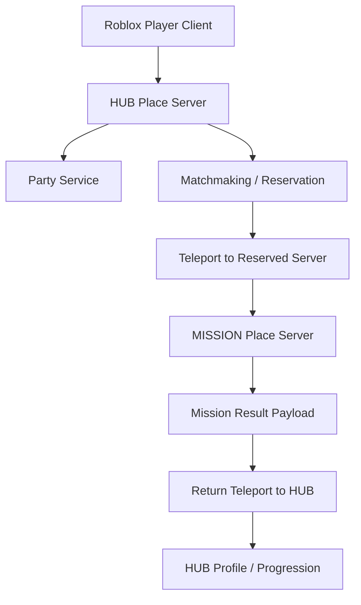
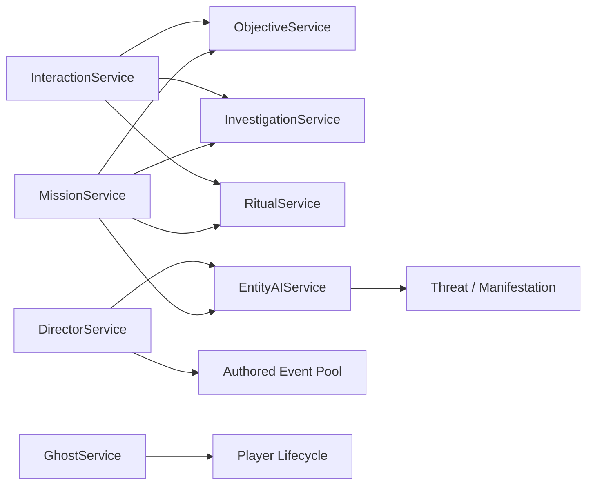

# THE LAST TURN — Architecture Overview

**Status:** Architecture baseline v1.0  
**Purpose:** Define system ownership and boundaries before gameplay implementation.

## 1. Deployment model



Each party receives an isolated mission server. A mission instance owns its own entity, Director, objective and evidence state. No cross-match mutable state is permitted.

## 2. Authority boundaries

| Concern | Authority | Client responsibility |
|---|---|---|
| Party membership | HUB server | Display party state, request actions |
| Match allocation | HUB server | Show launch/teleport status |
| Mission phase | MISSION server | Render phase and objectives |
| Evidence truth | MISSION server | Present discovered evidence |
| Inventory/resources | MISSION server | Request valid interactions |
| Entity AI/Director | MISSION server | Render replicated cues |
| Death/Ghost permissions | MISSION server | Camera and ghost controls |
| Rewards/profile | Server-side persistence flow | Display confirmed results |

A client request is never proof that an action succeeded.

## 3. Mission composition



MissionService owns phase transitions and coordinates subsystems. Subsystems own their own state and expose narrow APIs. Avoid circular dependencies; pass explicit dependencies during construction.

## 4. Mission lifecycle

- Create a unique mission session identifier and configuration seed.
- Validate joining players and initialize character/state.
- Start mission systems only after initialization succeeds.
- Enter phases through a guarded transition API.
- On completion/failure, freeze objective progression and calculate one result.
- Invalidate delayed callbacks and clean up connections/tasks.
- Teleport players back with bounded retry and a safe fallback message.

## 5. Data and configuration

Keep content configuration separate from runtime state:
- Entity definitions: authored evidence, abilities, behavior parameters.
- Event definitions: eligibility, phase constraints, cooldown, effects.
- Objective definitions: prerequisites, required contributions, completion conditions.
- Ritual definitions: steps, items and interruption behavior.
- Mission configuration: chosen location/entity/modifiers and deterministic seed.

Validate configuration at startup. A malformed config should fail safely with a useful server log, not softlock a live mission.

## 6. Cross-place contracts

The HUB-to-MISSION teleport payload should contain only validated, minimal data:
- schema version;
- opaque match/session identifier;
- party member identifiers;
- selected loadout identifiers;
- mission seed/config identifier;
- leader or matchmaking metadata required by the mission.

Do not trust arbitrary client-supplied teleport data. Validate membership and session on arrival. Never include secrets or long-lived credentials.

Mission result payload should be compact and versioned. The HUB validates the returning player/session before applying progression. Duplicate result delivery must not duplicate rewards.

## 7. Failure and recovery

Explicitly handle:
- Party leader disconnects before launch.
- Player disconnects during teleport.
- Reserved server allocation or teleport failure.
- Player arrives late or with invalid session data.
- Mission server shuts down unexpectedly.
- Player dies while objectives are active.
- All living players die.
- Player leaves while carrying a required resource.
- Mission completes while a player is teleporting.
- Result payload is missing, stale or delivered twice.

Each feature PR must cover the failure cases relevant to its scope. Do not attempt to solve every future failure mode with speculative framework code.

## 8. Network boundaries (TTL-02)

HUB and MISSION use identical networking conventions.

| Location | Contents | Visible to client |
|---|---|---|
| `ReplicatedStorage.Shared.Network` | `NetworkContract` (remote names, protocol version), `ClientNetwork`, diagnostic client | Yes (names only; not secrets, not authorization) |
| `ReplicatedStorage.Network.Requests` | Client -> server RemoteEvents, created by the server at startup | Yes |
| `ReplicatedStorage.Network.Notifications` | Server -> client RemoteEvents, created by the server at startup | Yes |
| `ServerStorage.ServerShared.Network` | `NetworkService`, `Validator`, `RateLimiter`, `NetworkConfig`, `DiagnosticHandshake` | No (server-only) |

Request pipeline (all client requests are untrusted):

1. Roblox supplies the `Player`; payloads never carry identity. Requests from players already leaving are dropped.
2. Per-player, per-request token-bucket rate limit (`NetworkConfig.RateLimits`). Rejected requests never reach the handler.
3. Schema validation (types, required/optional fields, string length, numeric bounds, no unexpected fields, no extra arguments). Failure is logged on the server and nothing is sent back.
4. A handler registered by server code for a name declared in `NetworkContract.Requests` runs in `pcall`.

Rules: one purpose-specific remote per request or notification; no generic dispatch; clients cannot create or register endpoints; `NetworkService.init()` is idempotent and runs in each server bootstrap before dependent systems; per-player limiter state is removed on `PlayerRemoving`. The `ClientReady` / `HandshakeAck` pair is a removable diagnostic and grants no authority.

## 9. Player lifecycle (TTL-03)

`PlayerStateService` (server-only, `ServerStorage.ServerShared.Player`) is shared by HUB and MISSION. Rules and storage live in the pure `PlayerStateCore`; the service only adds Roblox event handling. It initializes after `NetworkService.init()` in both bootstraps.

| State | Meaning |
|---|---|
| ALIVE | Alive and actively participating (initial state of every registered player) |
| DEAD | Died; post-death flow pending or being resolved |
| GHOST | In the ghost participation state |
| SPECTATING | Observing other players; not participating |
| RETURNING | Leaving the mission / returning to the HUB; terminal for the current lifecycle |

Allowed transitions (all others rejected; repeating the current state is an idempotent no-op):

```
ALIVE      -> DEAD, RETURNING
DEAD       -> GHOST, SPECTATING, RETURNING
GHOST      -> SPECTATING, RETURNING
SPECTATING -> RETURNING
RETURNING  -> (none)
```

There is intentionally no transition back to ALIVE; a future mission/respawn design decides how a new participation lifecycle begins.

- **Authority:** only server code calls `transition`. There is no remote and no client-supplied state. Transition reasons stay on the server (`onStateChanged` listeners).
- **Replication:** the server sets the Player attribute `LifecycleState` (name in `PlayerLifecycle.StateAttribute`). Clients read it with `player:GetAttribute` / `GetAttributeChangedSignal`; client-side writes do not replicate to the server and never affect authority. Trade-off: Player attributes replicate to all clients, so other players can see each player's state. Move to a per-player remote if a design requires hiding it.
- **Character handling:** lifecycle state is independent of the character. `CharacterAdded`/`CharacterRemoving` only (re)bind `Humanoid.Died`; they never change or reset state. Each character gets a token; callbacks from replaced characters are ignored. A missing Humanoid is awaited via `ChildAdded` (no wait loop) and the connection ends with the character. `Humanoid.Died` moves ALIVE -> DEAD only; death events in other states are ignored.
- **Cleanup:** `PlayerRemoving` disconnects all player/character connections and removes the state. `shutdown()` clears everything, including attributes; `init()` and `shutdown()` are idempotent.
- **Not included:** Ghost abilities, spectator camera/UI, respawn/revive, party, mission lifecycle, teleport, persistence.
