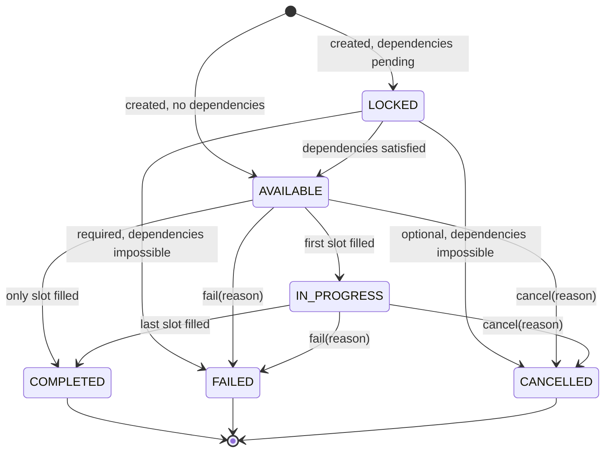
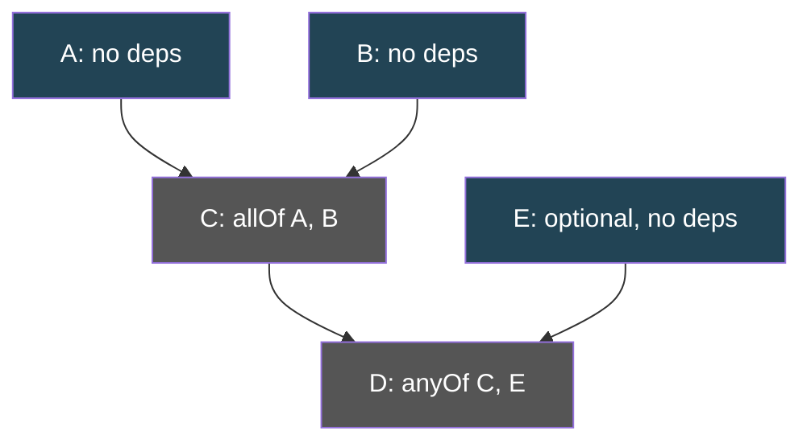
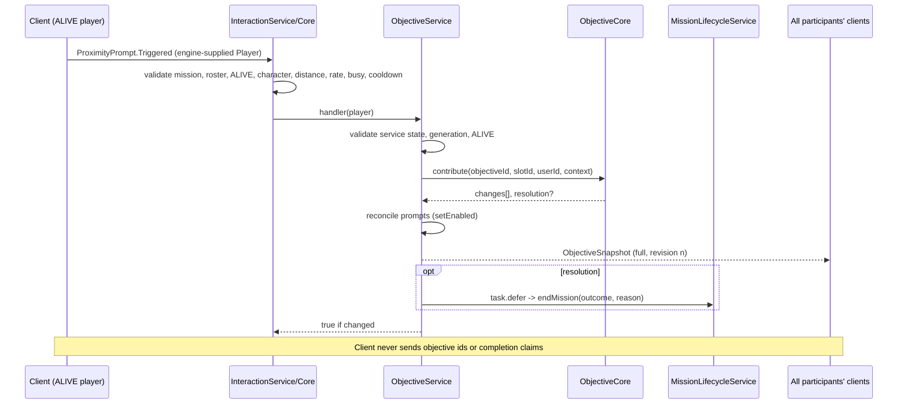
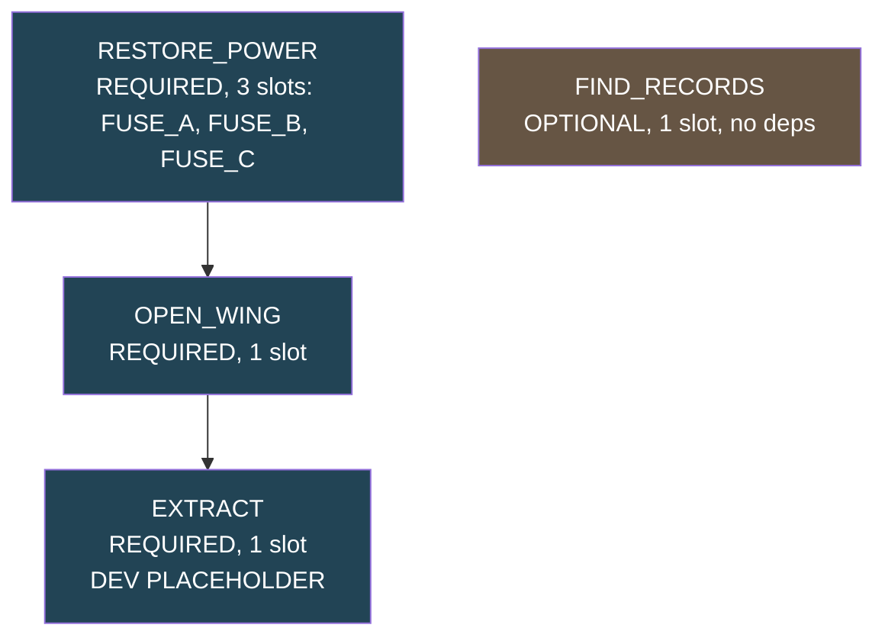
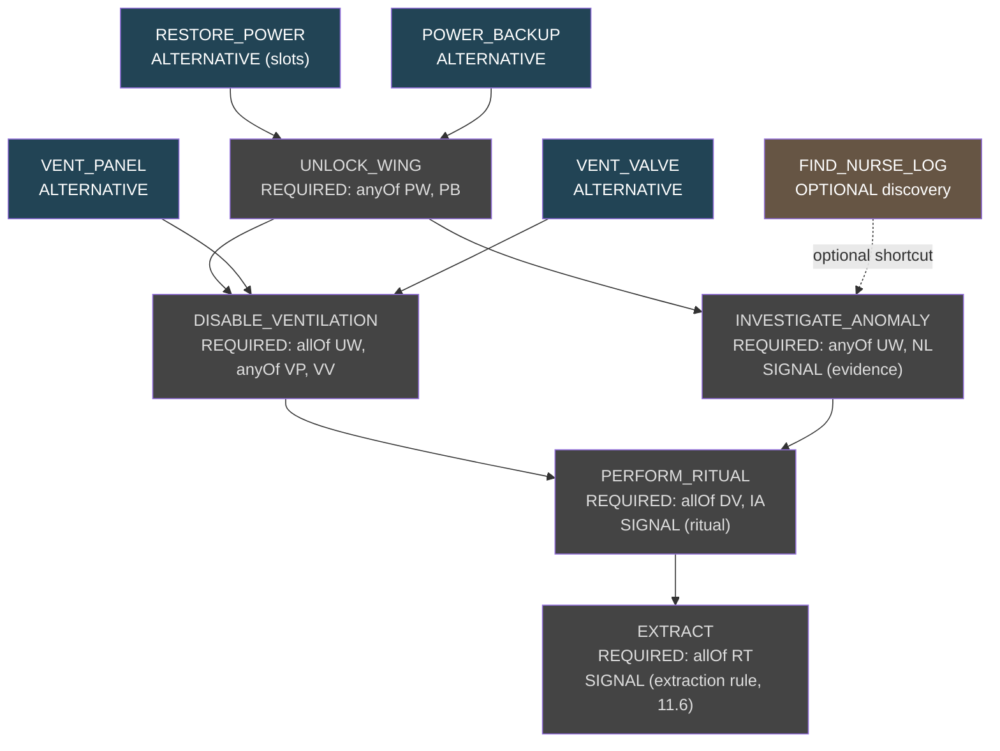

# TTL-09 — Objective System: Architecture & Technical Design

Status: **DESIGN PROPOSAL — documentation only (revision 3: architecture review fixes and live baseline verification; see section 18).** Nothing in this document is implemented. No Roblox Studio, multiplayer, mobile or published-Experience validation has been performed or is claimed. Luau code blocks below are type sketches and pseudo-signatures, not production code.

Scope: MISSION server (authoritative) and MISSION client (presentation). The HUB is not involved.

## 0. Reading guide

### 0.1 Index of the sixteen architecture questions

| # | Question | Answer in |
|---|---|---|
| 1 | What is an Objective? | 4.1 |
| 2 | Definition vs runtime instance? | 4.1, 4.2 |
| 3 | Lifecycle states? | 5 |
| 4 | Dependency representation and evaluation? | 6 |
| 5 | Completion-condition evaluation? | 5.4, 7 |
| 6 | How interactions connect to objectives? | 3.4, 7.3, 8.1 |
| 7 | Several players contributing to one objective? | 7 |
| 8 | Optional and branching objectives? | 6.4, 6.5 |
| 9 | Reaction to mission events? | 5.5, 11.4 |
| 10 | State replication to clients? | 8.2–8.4 |
| 11 | How UI receives updates? | 8.5 |
| 12 | Progress across death/disconnect? | 7.4, 10 |
| 13 | Duplicate completion, races, invalid requests? | 9 |
| 14 | Integration with MissionLifecycleService? | 11 |
| 15 | Mission completion and failure triggers? | 11.3, 11.5, 11.6 |
| 16 | Randomized variations later? | 4.6 |

### 0.2 One-paragraph summary

An **objective** is a server-owned node in a small, statically validated directed graph. Its **definition** is frozen content (id, importance, dependencies, a list of contribution slots, display text). Its **instance** is mutable state inside a pure, Lune-testable `ObjectiveCore` store. Each contribution slot is bound to one existing `InteractionService` registration; the interaction handler asks the Core to fill the slot, the Core applies the transition and any dependency cascade atomically, and a thin `ObjectiveService` adapter reconciles prompts, broadcasts a full snapshot to participants and, when the Core reports a resolution, asks `MissionLifecycleService` to end the mission. Clients never declare anything: they receive one server-to-client snapshot notification and may pull it once through one payload-less request.

## 1. Goals and non-goals

### 1.1 Goals

- A multi-stage mission model: sequential, parallel, dependency-gated and optional objectives (Task section 3).
- Team-owned progress with several contributions per objective; solo play always viable (`GAMEPLAY_RULES.md` section 3).
- Server-authoritative completion; clients are a projection only.
- Maximum pure, deterministic logic, testable under the existing Lune harness.
- Reuse the merged foundations (Network, PlayerState, MissionLifecycle, MissionConfig, Interaction) without a parallel implementation.
- Leave room, without building it, for alternative solutions, dynamic events, randomized variations, item deliveries and ritual/evidence completion.
- Mobile-readable objective presentation.

### 1.2 Non-goals

- A generic quest framework, scripting language, or data-driven effect system.
- Inventory, items, equipment, evidence, rituals, entity AI, Director, Ghost Mode, rewards, persistence. These are later tasks and will *call into* the objective system.
- Map authoring (TTL-10). The slice uses a runtime greybox fixture, following the TTL-08C door precedent.
- A new interaction mechanism. All physical contribution goes through `InteractionService`.
- Cross-server or persistent objective state. Objective state is ephemeral per mission server.
- Team-wipe detection, mission timeouts and extraction policy. These are separate mission-level concerns that *use* the objective system or the lifecycle; they are specified as separate components (11.5, 11.6) and are not part of TTL-09A–09C.
- Implementing any of the above in this task.

## 2. Existing architecture audit

### 2.1 Method and baseline caveat

The initial source audit was performed on the uploaded `THE-LAST-TURN-master.zip` (source tree, docs, tests, CI workflows). During the PR #20 review, the relevant baseline and merge history were cross-checked against live GitHub metadata:

- PR #19 is **merged** at `e001406da5aad571b9be30e8bda009d6f165d80f`. PR #20's base SHA is exactly that merge commit, so PR #20 is based on the master state containing PR #19; no rebase is required for this dependency.
- PR #13 (TTL-08C) is **merged** at `812e7d9fb635f4cbea0b39aa0e3e357c633e0074`. Its head workflow run #42 completed successfully. Roblox Studio runtime validation remains pending.
- PR #19's recorded validation passed both Rojo builds and 378 Lune tests (workflow runs #59/#60 completed successfully). Roblox Studio multiplayer, mobile and published teleport validation remain pending.
- The ZIP contains no `.git` directory, so its original snapshot alone could not establish these facts. The live cross-check above supersedes that limitation for PR #20's baseline. File names in the ZIP had em dashes mangled to `#U2014`; this is a ZIP-export artifact.

Nothing was assumed to exist because an older document names it. Every dependency below was confirmed in source.

### 2.2 Systems inspected

| System | Location | What it provides | Constraint that matters to TTL-09 |
|---|---|---|---|
| `NetworkContract` / `NetworkService` / `NetworkConfig` / `Validator` / `RateLimiter` | `src/shared/Network`, `src/server_shared/Network` | Purpose-specific remotes created by the server; per-request token bucket; fail-closed schema validation; `registerRequest` / `unregisterRequest` at runtime; `fireNotification(name, player, payload)`. | Every contract request **must** have a `NetworkConfig.RateLimits` entry (asserted at `init`). MISSION creates every contract remote, including party remotes. Rejections are never answered to the client. |
| `PlayerStateService` / `PlayerStateCore` | `src/server_shared/Player` | `ALIVE/DEAD/GHOST/SPECTATING/RETURNING`, `getState`, `onStateChanged`, server-owned `LifecycleState` attribute. | No transition back to `ALIVE`. Attribute is visible to all clients. |
| `MissionContextService` | `src/mission/server/MissionContext` | Validated teleport arrival context; `READY` only when all expected players arrived. | Late arrivals possible before `READY`; no rejoin behavior is specified after start. |
| `MissionLifecycleService` / `MissionLifecycleCore` | `src/mission/server/MissionLifecycle`, `src/server_shared/MissionLifecycle` | `registerSystem({name,start,stop})` (allowed only before `INITIALIZING`); systems start in registration order inside `pcall` during `INITIALIZING`, stop in reverse order; `endMission(outcome, reason)` (first call wins, idempotent); `isActive`, `getSession`; generation-guarded callbacks. | `isActive()` is false during `start`. Outcomes are only `COMPLETED/FAILED/ABORTED` with a reason token `[A-Za-z0-9_-]`, 1–48 chars. `endMission` stops systems **synchronously** (including `InteractionService`) and starts the return teleport immediately; there is no results grace period. |
| `MissionConfigService` / `MissionConfigCore` / `SeededRandom` / `MissionContent` | `src/mission/server/MissionConfig`, `src/server_shared/MissionConfig` | One frozen `MissionConfig` (v1: location only); per-stage isolated random streams; static frozen content validated by pure code; seed is server-only. | Selections are added as new fields with new stage labels. Seed/content must never be replicated. |
| `InteractionService` / `InteractionCore` / `InteractionConfig` | `src/mission/server/Interaction`, `src/server_shared/Interaction` | Server-created native `ProximityPrompt`; every activation re-validates mission active, roster, `ALIVE`, character, target, server-measured distance, shared rate limit, busy, cooldown; `register`, `unregister`, `setEnabled`. | See 2.3. |
| `DoorInteractionService` / `DoorCore` / `DoorFixture` | `src/mission/server/Door`, `src/server_shared/Door` | The only existing interaction consumer; precedent for a lifecycle system, a pure core plus thin service, and a runtime fixture. | Present in source (service, core, fixture, Bootstrap registration, specs, doc); owner review feedback states the same for current `master`. The roadmap status line lags (see 2.5). Merged code is not Studio validation. TTL-09 does not depend on it. |
| Client UI pattern | `src/shared/Mission/LaunchView.lua`, `src/shared/Party/PartyView.lua`, `src/shared/UI/{Layout,Messages}.lua`, `src/hub/client/**` | Pure, Lune-tested view/state modules in `src/shared`; thin controllers; injected clock; request-then-pull snapshots (`PartyRequestSnapshot`); `Layout.classify` compact/regular metrics. | MISSION client currently contains only the diagnostic handshake. |
| Test infrastructure | `tests/Harness.lua`, `tests/run.lua`, `docs/TESTING.md`, `.github/workflows/rojo-build.yml` | Minimal harness (`test`, `expectEqual/True/False/Error`); one `lune run tests/run` entry; both Rojo builds in CI. | Pure modules must be dependency-free and use injected collaborators so Lune can `require` them by path. No Roblox-runtime tests exist. |

### 2.3 Constraints discovered in `InteractionService` / `InteractionCore`

These shape the design directly.

1. The handler is `(player: Player) -> boolean`, **synchronous and non-yielding**. It receives no handle, no spec, no context. Closures carry identity.
2. **One registration per `BasePart` target.** Cooldown and busy flags are **per registration, global to all players** (not per player).
3. A handler returning `true` applies the cooldown; `false` or an error applies none and releases busy.
4. `HoldDuration` is UX only; the server sees only the completed `Triggered`.
5. Prompt texts (`actionText`, `objectText`) are fixed at `register` time; there is no later text setter (the door documents "no state-dependent prompt text").
6. There is **no client feedback channel** for interactions: normal rejections are silent.
7. `register` works only while the service is ready (after its own `start`, before its `stop`); consumers register from their own `start()`.
8. Only `ALIVE` roster members pass; `DEAD/GHOST/SPECTATING/RETURNING` and non-roster players are rejected upstream.
9. No line-of-sight validation (documented v1 limitation).

### 2.4 Missing foundations (must not be assumed)

| Missing | Consequence for this design |
|---|---|
| Authored mission map / Workspace mapping (`mission.project.json` has none) | Interaction anchors have no home. The slice builds a runtime greybox fixture (door precedent); TTL-10 replaces it with tagged map parts (D5). |
| Inventory / items / equipment (TTL-12) | "Resources" cannot be carried or delivered yet. Slice contributions are interaction-based slot fills. Item delivery is a later extension (7.6). |
| Evidence (TTL-11), Rituals (TTL-14) | Objectives completed by those systems need an externally signalled completion kind; reserved, not built (4.2, 15). |
| Any mission-level end condition besides `endMission` | There is no wipe detection and no mission timer. If every participant dies, nothing ends the mission. See D1; this is the most important open product/architecture decision. |
| Client feedback for rejected interactions | The objective HUD cannot explain a rejection. Acceptable for the slice. |
| Mission client UI | No mission HUD, no mission client controllers. |
| Reconnect/rejoin behavior | Not specified by TTL-05/06. Objective state keys on `UserId` so it is rejoin-safe if rejoin is ever allowed. |

### 2.5 Prerequisite, status and blocker assessment

Status vocabulary used in this document (it mirrors the roadmap's rule that merged code, automated checks and Studio validation are three different facts):

| Fact | Meaning here |
|---|---|
| **Implemented / merged** | The code is on `master`. |
| **Automated checks passed** | CI (both Rojo builds, `lune run tests/run`) passed on a stated head. Not independently re-run for this document. |
| **Studio runtime validation pending** | No Roblox Studio, multiplayer, mobile or published-Experience validation exists unless the roadmap explicitly records it. Merged code never implies it. |

Findings:

- Required and documented as merged: TTL-02 networking, TTL-03 player state, TTL-05 arrival context, TTL-06 lifecycle, TTL-07 mission configuration, TTL-08B-A `InteractionCore` (PR #11), TTL-08B-B `InteractionService` (PR #12).
- **TTL-08C (door consumer): merged (PR #13).** `DoorInteractionService`, `DoorCore`, the door fixture and the `DoorInteractionService` Bootstrap registration are present in source. PR #13 merged at `812e7d9fb635f4cbea0b39aa0e3e357c633e0074`; its head workflow run #42 completed successfully. Roblox Studio/published-Experience runtime validation remains pending.
- **TTL-HUB-02 follow-up: PR #19 merged.** PR #19 merged at `e001406da5aad571b9be30e8bda009d6f165d80f`; its PR description records both Rojo builds and 378 Lune tests passing, and workflow runs #59/#60 completed successfully. Studio multiplayer, mobile and published teleport validation remain pending.
- **PR #20 baseline.** PR #20 targets `master` at the exact PR #19 merge SHA above. The baseline dependency is therefore satisfied; no rebase is required.
- TTL-09 **does not depend on TTL-08C.** The design relies on `InteractionService` (merged, PR #12) and cites the door only as a structural precedent. It does not call, modify or require `DoorInteractionService`.

Conclusion: **the baseline dependency is satisfied**: PR #19 is merged and PR #20 is based on that merge. D9 is resolved by the live cross-check above. `CONTRIBUTING.md` ("do not start dependent work until prerequisites are merged") applies to TTL-09A+ implementation.

## 3. Proposed architecture and component responsibilities

### 3.1 Component overview

```mermaid
flowchart LR
    subgraph Pure["Pure Luau (server_shared) - Lune tested"]
        Graph[ObjectiveGraph<br/>static validation + dependency rules]
        Core[ObjectiveCore<br/>runtime store + state machine]
    end
    subgraph MissionServer["MISSION server (ServerScriptService.Objective)"]
        Content[ObjectiveContent<br/>frozen static data]
        Cfg[ObjectiveConfig<br/>tunables + validation]
        Svc[ObjectiveService<br/>lifecycle system + adapter]
        Fix[ObjectiveFixture<br/>greybox anchors - slice only]
    end
    subgraph Existing["Existing merged systems"]
        Life[MissionLifecycleService]
        Int[InteractionService / InteractionCore]
        PS[PlayerStateService]
        Net[NetworkService]
    end
    subgraph Client["MISSION client"]
        Ctl[ObjectiveController]
        View[ObjectiveView<br/>pure, src/shared]
        Hud[ObjectiveHud]
    end

    Content --> Graph
    Graph --> Core
    Svc --> Core
    Svc --> Cfg
    Svc --> Fix
    Svc -- registerSystem start/stop --> Life
    Svc -- register / setEnabled / unregister --> Int
    Int -- handler(player) --> Svc
    Svc -- getState --> PS
    Svc -- fireNotification / registerRequest --> Net
    Svc -- endMission(outcome, reason) --> Life
    Net -- ObjectiveSnapshot --> Ctl
    Ctl -- ObjectiveRequestSnapshot --> Net
    Ctl --> View
    View --> Hud
```



### 3.2 Responsibilities

| Module (proposed path) | Kind | Owns | Does not own |
|---|---|---|---|
| `src/server_shared/Objective/ObjectiveGraph.lua` | Pure | Content schema validation; graph rules (ids, cycles, reachability); dependency evaluation function. | Runtime state. |
| `src/server_shared/Objective/ObjectiveCore.lua` | Pure | All runtime state: instances, slots, revision, resolution; contribution, failure, cancellation, cascade; snapshot projection (copies). | Roblox objects, players, prompts, time source, remotes, mission end. |
| `src/mission/server/Objective/ObjectiveContent.lua` | Data | The frozen definitions of the mission(s). | Logic. |
| `src/mission/server/Objective/ObjectiveConfig.lua` | Data + pure helpers | Server-only tunables (interaction distance/cooldown, text limits) and their validation against `InteractionCore.validateSpec`. | State. |
| `src/mission/server/Objective/ObjectiveService.lua` | Roblox adapter | Lifecycle system registration; Core store creation; one interaction registration per slot; prompt reconciliation; snapshot broadcast; the pull request handler; calling `endMission`; cleanup. | Any rule. It never decides a transition. |
| `src/mission/server/Objective/ObjectiveFixture.lua` | Roblox (slice only) | Runtime greybox anchor parts and their logical point ids. | Gameplay. Replaced in TTL-10. |
| `src/shared/Objective/ObjectiveView.lua` | Pure | Client mirror of the last valid snapshot: stale-revision rejection, sanitization, tracked-list selection, change events for toasts. | Authority of any kind. |
| `src/mission/client/Objective/ObjectiveController.lua` | Roblox client | Subscribes to the notification, sends the single pull request, owns listeners and cleanup. | State rules. |
| `src/mission/client/UI/ObjectiveHud.lua` | Roblox client | Rendering for compact/regular layouts. | State, requests. |

Rule: **state lives in `ObjectiveCore` only.** The service holds handles and connections, never a second copy of objective state. Prompt enabled-state is derived from Core state by a single idempotent `reconcile()` step (see 3.5), so a failed side effect heals on the next reconcile.

### 3.3 Dependency direction

`ObjectiveService` depends on `MissionLifecycleService`, `InteractionService`, `PlayerStateService`, `NetworkService`; none of these depend on it. `ObjectiveCore`/`ObjectiveGraph` depend on nothing. Other future systems (Evidence, Ritual, Director, Rewards) depend on `ObjectiveService`'s narrow API, never the reverse. This matches `ARCHITECTURE.md` section 3 (explicit dependencies, no cycles).

### 3.4 How interactions connect to objectives

One slot = one interaction registration on one anchor part (the Interaction constraint "one registration per BasePart" maps exactly to "one contribution point per anchor").

```
slot definition  --pointId-->  anchor BasePart  --InteractionService.register-->  handle
handler(player) = function() return ObjectiveService.contribute(objectiveId, slotId, player) end
```

The interaction id is `OBJ_<OBJECTIVE_ID>_<SLOT_ID>` (token pattern, below the 64-character limit; validated). The closure captures only ids; it never captures state. `contribute` returns `true` only when the Core reports a state change, so a rejected or duplicate activation applies no cooldown.

### 3.5 Bootstrap and registration order

```lua
NetworkService.init()
PlayerStateService.init()
MissionContextService.init()
MissionConfigService.init()
InteractionService.init()
DoorInteractionService.init()      -- existing, untouched
ObjectiveService.init()            -- NEW: after InteractionService, BEFORE MissionLifecycleService.init()
MissionLifecycleService.init()
```

`ObjectiveService` registers after `Interaction`, so it starts after it and stops before it (it can unregister prompts while `InteractionService` is alive). Placing it after the door keeps the existing order untouched; the order between the two consumers is irrelevant because neither reads the other.

`reconcile()` (service-internal) sets each slot prompt to `enabled = objective is AVAILABLE or IN_PROGRESS and slot unfilled and not blocked`. It runs after every Core change and once at start.

## 4. Objective data model

### 4.1 What is an Objective? Definition vs instance

An **Objective** is a named, team-owned unit of mission progress with: an importance (required or optional), a dependency rule that decides when it becomes available, a completion rule (v1: a fixed set of contribution slots), and player-facing text.

- **Objective Definition** — immutable, authored, validated at startup, contains no runtime state, no Roblox objects, no player ids. Deeply frozen. Lives in server-only content.
- **Objective Instance** — mutable runtime record inside `ObjectiveCore`: state, per-slot filled flags and attribution, revision stamps. Created once per mission from the definitions, discarded at stop. Never persisted, never exposed by reference (only copied snapshots leave the Core).

### 4.2 Type sketches

```lua
export type ObjectiveId = string   -- ^[A-Z][A-Z0-9_]*$, <= 32 (MissionContent id convention)
export type SlotId = string        -- same pattern, unique within its objective
export type Importance = "REQUIRED" | "OPTIONAL"   -- "ALTERNATIVE" is reserved for TTL-09E (see 6.5)

export type DependencySpec = {
    allOf: { ObjectiveId }?,   -- every listed objective must be COMPLETED
    anyOf: { ObjectiveId }?,   -- at least one listed objective must be COMPLETED
}                              -- both absent: no dependency; both present: both must hold

export type SlotDefinition = {
    id: SlotId,
    pointId: string,           -- logical anchor id resolved by the binder (never a part name or path)
    label: string,             -- short UI/prompt text, <= 40 bytes (InteractionConfig.MaxTextBytes)
}

export type CompletionSpec =
    { kind: "SLOTS", slots: { SlotDefinition } }   -- slice: all slots must be filled
    -- RESERVED, not in the first slice:
    -- | { kind: "SIGNAL" }  -- completed by a trusted server system (ritual, evidence); see 15

export type ObjectiveDefinition = {
    id: ObjectiveId,
    importance: Importance,
    requires: DependencySpec?,
    completion: CompletionSpec,
    title: string,             -- <= 48 bytes
    description: string,       -- <= 140 bytes
    hiddenUntilAvailable: boolean?,   -- default false: a LOCKED objective is shown greyed
}

export type ObjectiveContent = {
    version: number,                      -- bumped when content changes (MissionContent convention)
    objectives: { ObjectiveDefinition },  -- dense array; array order = display order
}

export type ObjectiveState =
    "LOCKED" | "AVAILABLE" | "IN_PROGRESS" | "COMPLETED" | "FAILED" | "CANCELLED"

-- Runtime (inside ObjectiveCore only; never exposed by reference)
type SlotInstance = { filled: boolean, filledBy: number?, filledAt: number? }  -- filledBy = UserId
type ObjectiveInstance = {
    id: ObjectiveId,
    state: ObjectiveState,
    slots: { [SlotId]: SlotInstance },
    filledCount: number,
    changedAt: number,         -- injected clock
    reason: string?,           -- token for FAILED / CANCELLED
}
```

Provisional limits (validated by `ObjectiveGraph`, tunable): at most 32 objectives, 8 slots per objective, 8 ids per dependency list, texts without control characters. These bound the replicated payload (≈ 5–6 KB worst case at the recommended soft cap of 16 objectives × 4 slots).

`importance` is two-valued in the first milestones. Alternative solutions need a way to say "I may be skipped only if a sibling route is taken", which `OPTIONAL` cannot express under the mandatory progression rule (6.4). A third value, `ALTERNATIVE`, is therefore specified in 6.5 and reserved for TTL-09E; it changes no semantics of graphs that do not use it.

### 4.3 Static validation rules (`ObjectiveGraph.validate`)

Pure and deterministic. Fail-closed; the **first** problem in the fixed order below is returned as a code for server logs (same convention as `MissionConfigCore.validateContent`). Checks run in this order so the same invalid content always reports the same code:

1. **Structure:** plain tables only, no unexpected fields, dense arrays, finite integers, known `importance` values, text length/character rules, limits.
2. **Identity:** ids match the pattern and are unique; slot ids unique per objective; at least one slot (`CompletionSpec.kind = "SLOTS"`).
3. **References:** every dependency exists (`unknown_dependency`); no self-reference (`self_dependency`); no duplicates inside a list (`duplicate_dependency`); no empty `allOf`/`anyOf` array (`empty_dependency_list`; an empty `anyOf` would be vacuously unsatisfiable).
4. **Cycles:** iterative DFS in definition order (`dependency_cycle`). A cycle is a content error in every case, including cycles made only of `OPTIONAL` objectives; it is never a runtime state.
5. **At least one `REQUIRED` objective** (`no_required_objective`).
6. **Mandatory progression rule** (`required_not_guaranteed`): every `REQUIRED` objective must be *guaranteed completable by required-only play*. Precisely defined in 6.4. This replaces the earlier, insufficient "satisfiable if every other objective can complete" check.

An invalid content table does not crash the bootstrap: `ObjectiveService.init()` logs it and `start()` throws, which aborts the mission cleanly through the lifecycle (`ABORTED/initialization_failed`) — exactly what `MissionConfigService` does.

### 4.4 Why slots, not a bare counter

A counter ("3 contributions") cannot show *which* are done, cannot bind a distinct anchor to each contribution, and cannot guarantee idempotency per point. Slots give: one anchor per contribution, "required / delivered / remaining" UI (`GAMEPLAY_RULES.md` section 3), natural duplicate rejection (a slot fills once), and a clean extension to typed requirements later. A one-slot objective is the single-interaction case.

### 4.5 Content location

`ObjectiveContent.lua` lives in `src/mission/server/Objective/` (ServerScriptService on MISSION: never replicated). Definitions are authored data only; tests load the exact shipped table.

### 4.6 Randomized mission variations (later; no slice work)

Variations are a **build step before the Core**, not runtime mutation:

1. Content gains `variants` (alternative authored graph fragments with ids).
2. `MissionConfigCore` gains a new stage label (for example `config.objectives`, never reusing `config.location`) and a new `MissionConfig` field with the selected variant ids. Selection uses the existing isolated seeded streams with sorted ids, so it stays deterministic.
3. A pure `resolve(content, missionConfig) -> ObjectiveContent` produces the concrete graph, which passes through the same `ObjectiveGraph.validate`.

`ObjectiveCore` already receives a plain validated graph, so it needs no change. The slice uses the static table; the call path (`validate → Core.new`) is the same, so adding `resolve` later is additive. `ObjectiveService` never stores or replicates the seed.

## 5. Objective lifecycle and state transitions

### 5.1 States

| State | Meaning |
|---|---|
| `LOCKED` | Dependencies not yet satisfied. No interaction is enabled. |
| `AVAILABLE` | Dependencies satisfied, no contribution yet. Interactions enabled. |
| `IN_PROGRESS` | At least one slot filled, not complete. |
| `COMPLETED` | All slots filled (or, later, signalled). Terminal. |
| `FAILED` | Terminal failure with a reason token. |
| `CANCELLED` | Terminal, no longer relevant (dead dependency, replaced by an alternative, interrupted for good). Reason token. |

Terminal states never change. There is intentionally no transition back out of a terminal state (same philosophy as `PlayerStateCore`: restoring is a new objective, not a rollback).

### 5.2 Diagram



### 5.3 Transition rules

- A transition is accepted only along an edge in the table; anything else is rejected with `invalid_transition`; repeating the current state is an idempotent no-op (project convention from `PlayerStateCore` / `MissionLifecycleCore`).
- `LOCKED → AVAILABLE` is never requested by callers: the Core performs it automatically in the cascade (5.4).
- `fail` on a `REQUIRED` objective is accepted and resolves the mission as failed (11.3). `cancel` on a `REQUIRED` objective is **rejected** (`required_cannot_cancel`): a required objective can only end as `COMPLETED` or `FAILED`, so a mission can never quietly lose a required step. `OPTIONAL` (and later `ALTERNATIVE`) objectives may be cancelled.
- `fail` and `cancel` exist in the Core (09A) because dependency impossibility and mission resolution cannot be specified or tested without them. The service does **not** expose them until the first real consumer exists (09D), to avoid dead public API.
- Suspension is **not a state**. A future dynamic event "blocks" an objective by adding a reason token to a per-objective block set; effective availability is `state ∈ {AVAILABLE, IN_PROGRESS} and blocks is empty`. Interaction prompts are disabled through `reconcile()`. This avoids a state explosion and keeps block/unblock idempotent per token (09D; 11.4).

### 5.4 Cascade (deterministic)

After any applied change, the Core re-evaluates all `LOCKED` objectives in **definition order** until a full pass changes nothing (bounded: at most `N` passes, `N ≤ 32`). Each evaluation is the pure tri-state function of section 6. Because the order is fixed and the graph is acyclic, the same inputs always yield the same ordered list of changes. The change list is returned to the caller; the Core never calls out.

**Resolution is evaluated once, after the cascade reaches its fixpoint**, never in the middle of it, so the mission outcome never depends on the order in which cascaded changes were applied. `COMPLETED` (all required completed) and `FAILED` (a required objective failed) cannot both be true, because a failed required objective is not completed.

**Objective completion is not mission completion.** An objective reaching `COMPLETED` changes only that objective and its dependents. The mission resolves only through the table in 11.3.

### 5.5 How objectives react to mission events (design hook)

Objectives are reactive **only through the Core's narrow command surface**, called by trusted server systems through `ObjectiveService`:

| Command | Slice | Later |
|---|---|---|
| `contribute(objectiveId, slotId, userId, context)` | 09A/09B | — |
| `fail(id, reason)` / `cancel(id, reason)` | Core only (09A) | service API in 09D |
| `setBlocked(id, token, blocked)` | — | 09D (power failure, entity event) |
| `completeBySignal(id, sourceToken)` | — | 09E (ritual, evidence) |

Events never mutate the Core directly and never bypass the dependency rules: a signal for a `LOCKED` objective is rejected. Interrupting an in-progress physical action is done by disabling the prompt (a client-side hold is cancelled when the prompt is disabled); the server only ever sees completed activations, so there is no half-applied contribution to roll back.

## 6. Dependency evaluation model

### 6.1 Representation

A `DependencySpec` is a conjunction of two optional clauses: `allOf` (all listed objectives COMPLETED) and `anyOf` (at least one COMPLETED). Both clauses together mean both must hold. This is the minimum that supports sequential chains, fan-out (parallel), fan-in (join) and alternative routes, without a general expression language.

### 6.2 Tri-state evaluation (pure)

Each referenced objective is classified by its state:

- **COMPLETED** → satisfied;
- **FAILED / CANCELLED** → dead (can never be satisfied);
- anything else → pending.

```text
evaluate(spec):
  allOf  : SATISFIED if all satisfied; IMPOSSIBLE if any dead; else PENDING
  anyOf  : SATISFIED if any satisfied; IMPOSSIBLE if all dead; else PENDING
  result : IMPOSSIBLE if either clause is; SATISFIED if both clauses satisfied/absent; else PENDING
```

`IMPOSSIBLE` is what prevents softlocks: a `LOCKED` objective that can never unlock does not wait forever. `OPTIONAL` → `CANCELLED(dependency_unreachable)`. `REQUIRED` → `FAILED(dependency_unreachable)`, which resolves the mission as failed (11.3). Because validation (6.4) guarantees a required path exists, the required branch can only trigger after an explicit upstream `fail` at runtime; it is defense in depth, not a normal path.

Runtime semantics of `allOf` and `anyOf` are exactly as in 6.1 and are **not** changed by the validation rules: an `anyOf` is satisfied by *any* completed member, including an `OPTIONAL` one. Only the static *guarantee* check (6.4) treats optional members specially.

### 6.3 Dependency progression example



At start `A`, `B`, `E` are `AVAILABLE` simultaneously (parallel objectives). `C` unlocks when both `A` and `B` complete. `D` unlocks when `C` **or** `E` completes: `E` is a shortcut discovered optionally. With `D` required, this graph is valid under 6.4 because `D` has the required route `C`; `E` can only make it available earlier.

### 6.4 Optional objectives and the mandatory progression rule

`OPTIONAL` objectives never affect the mission-complete rule and a team may finish a mission without ever touching them. Therefore required progression must **never depend exclusively on an optional objective**. The validator enforces this with one precise, pure rule.

**Definition.** Process the validated (acyclic) graph and compute the *guaranteed set* `G`, the least fixpoint of:

```text
o ∈ G  iff  o.importance == REQUIRED
        and (o.requires.allOf is absent or every id in allOf is in G)
        and (o.requires.anyOf is absent or at least one id in anyOf is in G)
```

`OPTIONAL` objectives are **never** in `G`. The fixpoint is computed by repeated passes in definition order (at most `N` passes, `N ≤ 32`), so the result does not depend on ordering.

**Rule `required_not_guaranteed`.** Every `REQUIRED` objective must be in `G`. The first offender in definition order is reported.

Consequences (all follow from the definition; none changes runtime `allOf`/`anyOf` semantics):

- A `REQUIRED` objective whose `anyOf` contains **only** optional members is invalid.
- A `REQUIRED` objective whose `allOf` contains **any** optional member is invalid (the optional may be skipped, so the requirement could never be forced).
- A `REQUIRED` objective whose `anyOf` contains at least one required member in `G` is valid; optional members are extra, earlier routes.
- Validity is transitive: a required objective that depends on an invalid required objective is invalid too.
- `OPTIONAL` objectives have no guarantee requirement: their dependencies may be any existing acyclic objectives, including other optional ones. An optional objective whose dependencies become `IMPOSSIBLE` is cancelled at runtime (6.2) without affecting the mission.

**Examples** (illustrative ids):

| # | Graph | Verdict |
|---|---|---|
| 1 | `FIND_BACKUP_GENERATOR` OPTIONAL. `RESTORE_POWER` REQUIRED, `anyOf {FIND_BACKUP_GENERATOR}`. `OPEN_WING` REQUIRED, `allOf {RESTORE_POWER}`. | **Invalid** `required_not_guaranteed` at `RESTORE_POWER` (its only route is optional); `OPEN_WING` would fail transitively. |
| 2 | Same, but `RESTORE_POWER` REQUIRED `anyOf {FIND_BACKUP_GENERATOR, REPAIR_MAIN_BREAKER}` with `REPAIR_MAIN_BREAKER` REQUIRED, no deps. | **Valid.** `REPAIR_MAIN_BREAKER ∈ G`, so `RESTORE_POWER ∈ G`; the optional generator is an alternative shortcut. |
| 3 | `RESTORE_POWER` REQUIRED `anyOf {OPT_C}`; `OPT_C` OPTIONAL `allOf {OPT_B}`; `OPT_B` OPTIONAL `allOf {OPT_A}`; `OPT_A` OPTIONAL. | **Invalid.** A chain of optional objectives never enters `G`, however long. |
| 4 | `REQ_X` REQUIRED. `OPT_1` OPTIONAL `allOf {REQ_X}`. `OPT_2` OPTIONAL `allOf {OPT_1}`. Nothing required depends on `OPT_1`/`OPT_2`. | **Valid.** Optional chains hanging off required progress never block it. |
| 5 | `REQUIRED_Y` REQUIRED `allOf {REQ_X, OPT_1}`. | **Invalid.** An optional member in a required `allOf`. |
| 6 | `FIND_RECORDS` OPTIONAL, no dependencies, nothing depends on it. | **Valid** (the first-slice optional objective). |
| 7 | `A` `allOf {B}`, `B` `allOf {A}` (any importance). | **Invalid** `dependency_cycle` (reported before the progression rule). |
| 8 | A dependency naming a missing id; a self-reference; an empty `anyOf {}`. | **Invalid** `unknown_dependency` / `self_dependency` / `empty_dependency_list`. |
| 9 | `D` REQUIRED `anyOf {C, E}` with `C` REQUIRED in `G` and `E` OPTIONAL (section 6.3). | **Valid.** |

**Scope of the guarantee.** The rule proves only that the *dependency structure* lets a team finish using required objectives alone. It does not prove that required *content* is obtainable: when Inventory, Evidence or Ritual exist, those systems must validate their own content (for example, no required slot may need an item that only an optional objective grants, and no `SIGNAL` completion may depend on an optional-only source). That obligation is recorded for 09E/09F; the objective graph cannot see it.

### 6.5 Branching and alternative solutions (supported by the model; `ALTERNATIVE` arrives in TTL-09E)

Under 6.4, "restore power by main generator, backup source, or bypass" cannot be three `OPTIONAL` objectives feeding a required `anyOf`: that is exactly example 1 and would be rejected. What is needed is a way to say that *each route may be skipped, but not all of them*. This is the **more expressive rule**, specified now so the model does not block it, and implemented in 09E as an additive extension:

- New `importance = "ALTERNATIVE"`. It never counts for the mission-complete rule (like `OPTIONAL`).
- `G` is extended: `o ∈ G iff o.importance ∈ {REQUIRED, ALTERNATIVE} and its dependencies hold over G` (same `allOf`/`anyOf` conditions as 6.4). Graphs without `ALTERNATIVE` validate identically.
- `alternative_in_allof`: an `ALTERNATIVE` may appear only in `anyOf` lists, never `allOf`. (In an `allOf` it would be mandatory and should simply be `REQUIRED`.)
- `alternative_unreferenced`: an `ALTERNATIVE` must be referenced by at least one `anyOf` of a `REQUIRED` or `ALTERNATIVE` objective; otherwise it is really `OPTIONAL`.
- Runtime: an `ALTERNATIVE` with `IMPOSSIBLE` dependencies is `CANCELLED` (not `FAILED`) like an optional one. If *every* member of a required `anyOf` is dead, the required dependent becomes `IMPOSSIBLE` and the mission fails (`objective_unreachable`), which is correct: the team destroyed every route.

| Example | Verdict |
|---|---|
| `POWER_MAIN`, `POWER_BACKUP`, `POWER_BYPASS` ALTERNATIVE; `UNLOCK_WING` REQUIRED `anyOf {all three}` | Valid. All three are in `G`, so the required objective is guaranteed. |
| Same three marked `OPTIONAL` | Invalid (`required_not_guaranteed`), exactly example 1. |
| `UNLOCK_WING` REQUIRED `allOf {POWER_MAIN}` with `POWER_MAIN` ALTERNATIVE | Invalid `alternative_in_allof`. |

Not built until 09E: an *exclusive group* (when one alternative completes, cancel its siblings so the UI stops showing them). It is a small additive Core rule (`group` tag → cancel siblings on completion). Until then, losing alternatives simply remain available, which is harmless and solo-safe. Each alternative must individually be completable by a single player (7.2).

### 6.6 Dependencies and dynamic modification

Dependencies are static content for the whole mission. A dynamic event that wants a different route does so by *blocking* objectives (5.3) or, in 09E, by adding an `anyOf` shortcut through a signalled optional objective. The graph itself is never rewritten at runtime; this keeps validation (acyclicity, the mandatory progression rule) a startup-only guarantee.

## 7. Contribution model

### 7.1 Principles

- **Progress is team-owned** (`GAMEPLAY_RULES.md` section 3). A slot belongs to the objective, not to whoever first interacted.
- A slot fills **once**. Further attempts are rejected (`already_filled`).
- Any eligible participant may fill any open slot. No slot is bound to a specific player; **no objective may require one specific player**.
- `filledBy` (UserId) is stored for attribution (future rewards/credit/diagnostics). It never gates anything and is not replicated in the slice.

### 7.2 Solo viability

All slice objectives are completable by one player acting alone, in any order of slots. Cooperation is encouraged by **spatial distribution** and **time pressure from threats** (later systems), not by hard multi-player locks. Simultaneous-presence mechanics ("one operates the panel while another handles the mechanism") are explicitly deferred (7.6) and must ship with a documented solo alternative before becoming required. The same applies to extraction: any future `ALL_LIVING`/quorum policy (11.6) must count only *living, connected* participants, so a single player, or the last survivor, can always satisfy it. Under 6.4/6.5 every route a required objective can be unlocked by is individually completable by one player.

### 7.3 Contribution flow

```text
ProximityPrompt.Triggered(player)
  -> InteractionService: mission active, roster, ALIVE, character, target, distance, rate limit, busy, cooldown
  -> slot handler(player)
  -> ObjectiveService.contribute(objectiveId, slotId, player)
       checks: service running, generation, player.Parent == Players, state == ALIVE (single choke point)
       -> ObjectiveCore.contribute(...)        -- pure; atomic; returns ordered changes + resolution
       -> reconcile prompts, broadcast snapshot
       -> if resolution: defer endMission (11.3)
  -> returns changed (true applies the interaction cooldown)
```

### 7.4 Death and disconnect

- A contributor dying or leaving **never rolls back** a filled slot. The Core stores only a `UserId` number (no `Player` reference).
- A player who dies or disconnects before activating contributes nothing and changes nothing.
- Because slice contributions are instantaneous slot fills, there is **no carried state** that can be lost. This satisfies "a required item must never become permanently inaccessible" trivially for the slice.

### 7.5 Party size

Slot counts are fixed per objective in v1. `GAMEPLAY_RULES.md` section 5 asks that solo/small parties not be punished by 8-player assumptions: v1 satisfies this by never requiring more *simultaneous* people, only more *actions*. Size-band variants (different slot counts per party size) are a content-variant concern (4.6) and a playtest question (D6).

### 7.6 Later extensions (additive)

| Extension | How it fits |
|---|---|
| Typed contributions (item X from inventory) | Slot gains a `requirement` field; the contributor passes an inventory check supplied in the Core `context`. Slot remains one-shot. |
| Several resource types per objective | Several slots with different requirements. |
| Simultaneous / channeled actions | Needs a transactional, possibly asynchronous interaction design (the current handler is synchronous and non-yielding). Owned by TTL-14 or a dedicated interaction milestone (D7). |
| Quorum ("N distinct players") | `minDistinctContributors` evaluated from `filledBy`; must be solo-safe by design. |

## 8. Server/client communication

### 8.1 Flow



### 8.2 New network surface (two names only)

| Name | Direction | Payload | Notes |
|---|---|---|---|
| `ObjectiveSnapshot` | server → client (Notification) | Full snapshot, see 8.3 | Sent to every connected roster player on every change and on pull. |
| `ObjectiveRequestSnapshot` | client → server (Request) | **none** (`args = {}`) | Pull after the client connected its listener (same pattern and reason as `PartyRequestSnapshot`: a push at start can be missed). Rate limit entry in `NetworkConfig`, proposed `capacity = 3, refillPerSecond = 0.5`. |

No request carries an objective id, slot id, count, player id or state. There is **no remote that can complete, fail, or modify anything.** The handler accepts only roster members while the service is running, and answers by sending the requester's snapshot.

A full snapshot per change (instead of deltas) is deliberate: ≤ 16 objectives, change events number in the dozens per 15–20-minute mission, and `RemoteEvent` delivery is reliable and ordered per remote. A monotonic `revision` lets the client drop stale payloads; no gap detection or resync protocol is needed. Deltas are a later optimization only if payload measurements justify them (D10).

**Synchronization rules.** (1) The server sends a snapshot at start (clients may not have connected yet: that push can be lost, which is exactly why the pull exists) and after every applied change. (2) A pull answers **only the requester** with the *current* revision; it never re-broadcasts. (3) The client starts with `lastRevision = -1` and accepts a payload only if `revision > lastRevision`; the initial snapshot has revision `0`, so it is accepted, and an equal-revision duplicate (push and pull racing) is harmlessly dropped. (4) Revisions are per mission server and reset with the mission; there is no cross-mission continuity. (5) Because every snapshot is complete, missing intermediate revisions need no repair.

### 8.3 Snapshot payload

```lua
export type SlotEntry = { label: string, filled: boolean }

export type ObjectiveEntry = {
    id: string,
    title: string,
    description: string,
    importance: "REQUIRED" | "OPTIONAL",
    state: "LOCKED" | "AVAILABLE" | "IN_PROGRESS" | "COMPLETED" | "FAILED" | "CANCELLED",
    filled: number,
    required: number,
    slots: { SlotEntry },
}

export type ObjectiveSnapshot = {
    v: number,                       -- payload schema version (1)
    revision: number,                -- monotonic per mission, +1 per applied change
    objectives: { ObjectiveEntry },  -- definition (display) order
}
```

Replication rules:

- Objectives with `hiddenUntilAvailable = true` that are still `LOCKED` are **omitted**, not sent as "hidden". Hidden information is never sent and masked in UI (`TECHNICAL_SPEC.md` section 7).
- Not sent: seed, content version, `pointId`, anchor names, `filledBy`/UserIds, reasons/tokens, block tokens, timestamps.
- The payload is identical for every participant. `GHOST`/`SPECTATING`/`DEAD` players receive the same read-only view as living players, so ghosts gain no information advantage (`GAMEPLAY_RULES.md` section 6).
- Strings are server-sourced literals bounded by content validation (D4 discusses localization keys).

### 8.4 Why not Player/Workspace attributes

`PlayerStateService` uses an attribute because it is one small value per player. Objective state is structured and team-wide; attributes would replicate to all clients without ordering/atomicity across keys. One notification keeps the whole state internally consistent and follows the Party precedent.

### 8.5 UI update path and mobile constraints

`ObjectiveController` connects `ObjectiveSnapshot` first, then sends `ObjectiveRequestSnapshot` once. The pure `ObjectiveView` validates shape and bounds (never trusting the payload blindly), drops `revision <=` the last accepted (initially `-1`), and exposes:

- `tracked(maxLines)`: REQUIRED objectives that are `AVAILABLE`/`IN_PROGRESS` first, then OPTIONAL, never more than `maxLines`, plus a "+N more" count;
- `events(previous, current)`: derived toast events (unlocked, completed, optional found) from snapshot diffs, so no extra remote is required.

Mobile rules (reuse `Layout.classify/metrics`; the compact class already uses 48 px targets):

- Compact tracker anchored top-left, below the Roblox top bar, clear of the left thumbstick and right-side action buttons; at most 3 lines; tap to expand the full list (≥ 48 px target).
- Progress as text ("2/3") and shape, never color alone (`GAMEPLAY_RULES.md` section 8).
- Short copy (title ≤ 48 bytes, slot label ≤ 40 bytes). Toasts last ~3 s and do not steal input focus.
- No per-frame updates; the UI redraws only on a snapshot.

## 9. Security and validation rules

| Threat | Mitigation | Where |
|---|---|---|
| Client claims completion / progress | No such remote exists; the only request has no payload; clients cannot name an objective | `NetworkContract`, `Validator` (`args = {}`) |
| Forged or spammed prompt activation | `ProximityPrompt` is not the boundary; the server rebuilds every fact, shared `Interact` bucket (cap 5, 2/s) | `InteractionService` (existing) |
| Dead / ghost / spectating / returning / non-roster contributor | Rejected upstream; `ObjectiveService.contribute` re-checks `ALIVE` as the single choke point for non-interaction sources later | `InteractionService` + service |
| Duplicate completion / double slot fill | Slot fills once; terminal states immutable; resolution is sticky; handler returns `false` on no-change (no cooldown) | `ObjectiveCore` |
| Race: two players, same slot, same frame | Handlers are synchronous and non-yielding, so activations serialize; the second sees `already_filled`; the Core is the single arbiter | Interaction contract + Core |
| Late/replayed callbacks after stop or mission end | Generation token captured in closures; handles invalidated; service marks itself unavailable first; `missionActive` check upstream | `ObjectiveService`, `InteractionService` |
| Re-entrant mission end during a handler | `endMission` is **deferred** with `task.defer` guarded by generation; never called synchronously inside the interaction handler (it would stop `InteractionService` mid-activation) | `ObjectiveService` |
| Information leak | Hidden objectives omitted; no seed/content/pointIds/UserIds; same view for ghosts | Snapshot projection |
| Snapshot request flooding | Token bucket; roster-only; no work beyond one `FireClient` | `NetworkService` |
| Malformed / oversized server payload | Content validated and bounded at startup; client view re-validates | `ObjectiveGraph`, `ObjectiveView` |
| Content tampering | Content lives in ServerScriptService, deeply frozen | Rojo mapping, `table.freeze` |
| Interaction through thin walls | Known v1 limitation (no line of sight). Mitigation is level design: critical anchors must not be reachable through a wall by skipping gameplay; track in TTL-10/TTL-31 | Documented risk (R3) |
| Unauthorized mission end | Only `ObjectiveService` server code calls `endMission`; first call wins, idempotent | `MissionLifecycleService` |

Server logs carry reasons; **nothing is ever sent back to a client about a rejection** (existing convention).

## 10. Player lifecycle integration

| Player state / event | May contribute | Objective effect |
|---|---|---|
| `ALIVE` roster member, connected | Yes (after Interaction checks) | Slot fills; team progress changes |
| `DEAD`, `GHOST`, `SPECTATING` | **No** (Interaction rejects; service re-checks) | None. Still receive snapshots (read-only) |
| `RETURNING` | No | None |
| Not on `expectedUserIds` | No | None; pull request ignored |
| Disconnect (any time) | n/a | Filled slots stay filled; no rollback; no `Player` references held |
| Death while others progress | n/a | Progress is team-owned; nothing is lost |

`PlayerStateService` is used **read-only**: `getState(player)` in the contribution path. The objective system does not write player state and does **not** subscribe to transitions. Team-wipe detection (all participants dead/ghost/disconnected) is **not** an objective concern; it belongs to an independent mission-level component specified in 11.5, which uses `PlayerStateService` and `MissionLifecycleService` and does not touch the Core.

Carrying/dropping items on death belongs to the future inventory system. Its contract with objectives: only a *confirmed delivery* (a successful `contribute`) is irreversible; an undelivered item is never counted.

## 11. Mission lifecycle integration

### 11.1 Registration and start

`ObjectiveService.init()` is idempotent, validates `ObjectiveConfig` and the content table, logs a problem (without throwing), and calls `MissionLifecycleService.registerSystem({ name = "Objective", start, stop })`. Registration failure throws (programming error, same as `InteractionService`).

`start(session)` runs during `INITIALIZING` inside the lifecycle's `pcall` and **throws to abort** on any problem. It: re-validates content; copies `session.expectedUserIds` into a roster set (never retains the session table); creates `ObjectiveCore` with the injected clock; builds anchors (fixture); registers one interaction per slot through `InteractionService.register` (initially disabled); registers the pull request handler via `NetworkService.registerRequest`; reconciles; sends the first snapshot; publishes ready last. Nothing completes during start: `InteractionCore` rejects activations while `isActive()` is false.

Binding failures: a missing anchor or rejected registration for a slot of a **REQUIRED** objective throws (mission aborts, players return to the HUB — a loud content error instead of a silent softlock). For an **OPTIONAL** objective the Core cancels it (`binding_failed`) and the mission proceeds with a warning.

### 11.2 Stop

`stop()` is idempotent and safe after a partial start. Order: mark unavailable; bump generation; `NetworkService.unregisterRequest`; unregister every interaction handle (while `InteractionService` is still alive, because lifecycle stops systems in reverse order); destroy fixture parts; drop Core, roster and handles. Consumers must drop any reference they hold (as with `MissionConfigService.getConfig()`).

### 11.3 Completion and failure triggers (Question 15)

The Core returns a **resolution** after every change; the service acts on it once:

| Condition (evaluated after each change) | Resolution |
|---|---|
| Any `REQUIRED` objective is `FAILED` | `FAILED`, reason `objective_failed` |
| A `REQUIRED` objective became unreachable (`dependency_unreachable`) | `FAILED`, reason `objective_unreachable` |
| Every `REQUIRED` objective is `COMPLETED` | `COMPLETED`, reason `objectives_complete` |

Resolution is sticky (first wins). All reason tokens satisfy the lifecycle's `[A-Za-z0-9_-]{1,48}` rule. The service then calls `task.defer` → `MissionLifecycleService.endMission(outcome, reason)` after checking the captured generation. `endMission` itself is idempotent, so a concurrent end (server shutdown, another system) is harmless.

The service never evaluates player states to decide an outcome. Not objective-owned and therefore **not** in this table: team wipe (11.5), mission timeout, extraction policy (11.6), and richer outcomes such as "escape with incomplete investigation" (D8; encoded later as reason tokens plus the results payload of TTL-25). The objective system exposes a read-only summary when that consumer exists.

Policy hook: because `endMission` returns players immediately, the service calls an injected `onResolved(outcome, reason)` that defaults to `endMission`. A future results/grace phase (D3) changes the hook, not the Core.

### 11.4 Dynamic events

Future systems (Director, entity, power) act through the command table in 5.5, called from server code during `ACTIVE`. They never touch Core state directly and never call `endMission` for objective reasons; the Core decides.

### 11.5 Team wipe is a separate mission-level component (not part of TTL-09)

**Ownership.** `ObjectiveCore` owns objective state only. `ObjectiveService` adapts the Core to Roblox and never decides an outcome from player states. Detecting that the *team* can no longer act is a mission-outcome rule; it needs the player states and the ability to end the mission, and nothing from objectives.

**Proposed shape (documentation only; not implemented in PR #20 or TTL-09A–09C).** An independent lifecycle system, working name `MissionOutcomeService` (pure `TeamWipeCore` plus a thin adapter, same split as the rest of the repository):

| Aspect | Design |
|---|---|
| Inputs | Roster from the lifecycle session; `PlayerStateService.getState` / `onStateChanged`; player connection facts from the roster/`Players` (as `InteractionCore` already receives them) |
| Output | `MissionLifecycleService.endMission("FAILED", "team_wiped")` |
| Registration | `MissionLifecycleService.registerSystem`, like every other mission system; stops with the lifecycle; generation-guarded deferred evaluation |
| Does **not** | Introduce a second player-state store, a second lifecycle, or any dependency on `ObjectiveService`; neither component imports the other |
| Concurrency with objectives | Both may call `endMission`; the lifecycle's first-call-wins rule decides. The wipe evaluation is deferred and re-checks `isActive()` first, so a same-frame objective resolution is not overridden |
| Roadmap | Needs its own task number and owner approval (D1). It must exist before the failure path of Gate 1 can be claimed; until then a total wipe leaves the mission running (known risk R9) |

**Recommended policy for review by the product owner** ("eligible" = connected roster member whose state is `ALIVE`, since `GAMEPLAY_RULES.md` section 6 forbids normal objective interactions for `DEAD`/`GHOST`/`SPECTATING`):

| Situation | Treatment |
|---|---|
| All participants `DEAD` | Team wipe → `FAILED/team_wiped` |
| All participants `GHOST` | Team wipe by default. Changes only if Ghost Mode (TTL-21) is designed so ghosts can perform mission-affecting actions; that decision belongs to TTL-21 |
| Mixture of `DEAD`, `GHOST` and `ALIVE` | **Not** a wipe while at least one connected participant is `ALIVE`; the mission continues and dead/ghost players keep their read-only view |
| Mixture of `DEAD` and `GHOST` only (no `ALIVE`) | Team wipe |
| A participant disconnects | Removed from the connected set; their last state does not count as alive. If they were the last connected `ALIVE` participant, a wipe evaluation follows. A reconnect grace period is a product/tuning question and is out of scope because no rejoin behavior exists today |
| No connected `ALIVE` participants remain (including `SPECTATING`/`RETURNING` only, or everyone disconnected) | Team wipe, unless the mission already resolved. Behavior of an empty server stays whatever the existing lifecycle does; this component does not change it |
| Solo player dies | Team wipe (the only participant is the whole team) |

Objectives are unaffected by a wipe: nothing is failed or cancelled; `ObjectiveService.stop()` simply clears state when the lifecycle stops systems.

### 11.6 Extraction is a separate gameplay condition (not an objective-system rule)

An objective being `COMPLETED` never means "someone pressed a button and the mission ends". The mission ends when every `REQUIRED` objective is `COMPLETED` (11.3). `EXTRACT` is simply the last required objective in a typical mission; **how it becomes completed is a gameplay policy that must not be hardcoded into the Core.**

Policies the design must remain able to support later, each evaluated by an extraction component using only living, connected participants:

| Policy | Meaning |
|---|---|
| `ANY_ELIGIBLE` | One eligible player reaching extraction completes it |
| `ALL_LIVING` | Every living connected participant must be at extraction (dead/ghost/disconnected excluded, so a solo player or last survivor can satisfy it) |
| `QUORUM` | A configured count or fraction of living participants |
| `TIMEOUT` / forced extraction | A countdown starts at the first (or quorum) arrival; at expiry the objective completes and what happens to stragglers is a product decision |

Mechanically the future extraction component evaluates the policy and then completes `EXTRACT` through the reserved `SIGNAL` completion (09E). The Core receives only "this objective is completed by a trusted source"; it never learns which players were present. Inventory, Evidence and Ritual integrate the same way: they own their conditions and signal completion, while the objective graph owns only ordering and state.

**First slice.** To keep the slice simple and exercise the lifecycle path, `EXTRACT` is a single-slot **DEV PLACEHOLDER**: one interaction by any `ALIVE` participant completes it, and the lifecycle then returns *everyone*. This is not a product decision. It would let one player end the run for a cooperating team, so it must not be used to judge cooperative gameplay in playtests, and it is replaced when the extraction component exists. **The final extraction rule requires product-owner approval before TTL-10** (D2).

## 12. Error handling and recovery

| Failure | Behavior |
|---|---|
| Invalid content or config | Logged at `init`; `start` throws; mission aborts (`initialization_failed`) and players return |
| Required anchor missing / registration rejected | `start` throws (abort) |
| Optional anchor missing | Objective `CANCELLED(binding_failed)`, warning, mission continues |
| `InteractionService.setEnabled` fails | Core state is unaffected; next `reconcile()` converges prompts |
| Snapshot `FireClient` error for one player | `pcall` per player; others still receive it; the player can pull |
| Handler error in a contribution | `InteractionCore` logs it, releases busy, applies no cooldown; Core mutation is atomic (validate fully, then mutate), so state is never half-applied |
| `endMission` rejected or already ended | Ignored; first result wins |
| Player disconnects mid-mission | No state change; broadcast skips disconnected players |
| Server shutdown | Lifecycle stops systems; `stop()` clears everything; no delayed work survives (generation guard) |
| Duplicate `start` | Throws (fail closed), like the other systems |
| Client receives malformed/stale snapshot | `ObjectiveView` ignores it and keeps the last valid state |

Recovery principle: state cannot be corrupted by presentation failures, and presentation self-heals from the next snapshot or pull.

## 13. Test strategy

All pure logic is tested with Lune in the existing harness, registered in `tests/run.lua`. Collaborators (clock, content) are injected.

| Spec (proposed) | Milestone | Covers |
|---|---|---|
| `tests/server_shared/ObjectiveGraph.spec.lua` | 09A | Structure/identity/limits/text rules; unknown, self, duplicate and empty dependencies; cycles (2-node, long, optional-only); no required objective; **mandatory progression rule: every example in the 6.4 table as a test (required depending only on optional; required `anyOf` with optional and required members; required `allOf` with an optional member; chains of optionals; optional chains off required nodes; transitive invalidity)**; deterministic first-error ordering; fixpoint independent of definition order; frozen input unchanged |
| `tests/server_shared/ObjectiveCore.spec.lua` | 09A | Initial states; roots available; contribute → `IN_PROGRESS` → `COMPLETED`; cascade unlock and ordering; simultaneous active objectives; optional does not block resolution; `anyOf` alternative; duplicate fill; unknown objective/slot; locked/terminal rejection; ineligible contributor; invalid user id/time; `fail`/`cancel` edges; impossible dependency (optional → cancelled, required → failed); resolution sticky and reasons; revision monotonic and only on change; snapshot omits hidden, is a copy, never exposes ids/reasons; invariants checker |
| `tests/server_shared/ObjectiveContent.spec.lua` | 09A | The shipped content passes `ObjectiveGraph.validate`; slice acceptance properties (≥ 3 objectives, ≥ 1 multi-slot, ≥ 1 optional, ≥ 1 dependency edge) |
| `tests/server_shared/ObjectiveConfig.spec.lua` | 09B | Shipped tunables valid; generated interaction specs pass `InteractionCore.validateSpec`; ids ≤ 64 chars for every slot; texts within `InteractionConfig` limits |
| `tests/shared/ObjectiveView.spec.lua` | 09C | Stale/duplicate revision; malformed payload; bounds; `tracked` ordering and `+N`; `events` diff; unknown state fallback |
| `tests/shared/Messages.spec.lua` (extended) | 09C | New objective strings |

Not coverable by Lune (service wiring, Instances, prompts, remotes, UI): reported as **not run** until the Studio checklist is executed. Proposed Studio/published-Experience checklist (all pending):

1. Greybox anchors and native prompts appear; locked objectives show no usable prompt.
2. Slot fill by an `ALIVE` participant updates all clients; objective state in HUD matches the server.
3. Dependent objective unlocks exactly when its prerequisites complete.
4. Two players hit the same slot simultaneously: exactly one fill.
5. `DEAD`/`GHOST`/`SPECTATING`/non-roster players cannot fill slots.
6. Contributor dies or disconnects after a fill: progress remains.
7. Optional objective completion does not end the mission.
8. Completing all required objectives ends the mission `COMPLETED`/`objectives_complete` once, players return.
9. Mission shutdown/abort: prompts and request handler removed; no late snapshots.
10. Late/second `ObjectiveRequestSnapshot` is harmless; request spam is rate limited.
11. Solo, 2, 4 and (later) 8 players.
12. Mobile: tracker readability, tap targets, no overlap with controls.
13. Edge-of-radius prompt versus server acceptance (existing tolerance, tracked in TTL-08B).

## 14. First implementation slice

### 14.1 Content (illustrative IDs; final copy is a content task)



| Requirement from the Task | Satisfied by |
|---|---|
| ≥ 3 objectives | 4 objectives |
| Dependency-based unlocking | `OPEN_WING` requires `RESTORE_POWER`; `EXTRACT` requires `OPEN_WING` |
| ≥ 1 objective with multiple contributions | `RESTORE_POWER` (3 slots, any players, any order, solo-completable) |
| ≥ 1 optional objective | `FIND_RECORDS`, also demonstrates parallel active objectives |
| Server-authoritative completion | Core + service only; no completion remote |
| Client-visible updates | `ObjectiveSnapshot` + HUD |
| Mission lifecycle integration | `registerSystem`; `endMission(COMPLETED, objectives_complete)` after the placeholder `EXTRACT` |

`EXTRACT` in the slice is a **dev placeholder** (a single interaction by any `ALIVE` participant), explicitly *not* the extraction rule; see 11.6. The final rule requires product-owner approval before TTL-10 (D2). The slice content is valid under the mandatory progression rule: `FIND_RECORDS` is optional and nothing required depends on it.

### 14.2 Includes

`ObjectiveGraph`, `ObjectiveCore`, content, config, `ObjectiveService`, runtime greybox fixture, two network names with one rate-limit entry, minimal HUD, tests and docs.

### 14.3 Intentionally deferred

Branching content and exclusive groups, `SIGNAL` completion, blocks/dynamic events, randomized variants, item deliveries, simultaneous/channeled actions, extraction policies and the extraction component (11.6), the team-wipe component (11.5), timeouts, results presentation, rewards, map-authored anchors, `fail`/`cancel` service API, per-player contribution UI, waypoints/markers.

## 15. Proposed PR breakdown

The suggested 09A/09B/09C split is justified by the audit; one change is proposed: the shipped content table is part of 09A (so tests prove the slice graph before any service exists), and the network contract additions go in 09B (the server owns remote creation) rather than 09C.

| PR | Scope | Files (indicative) | Depends on |
|---|---|---|---|
| **TTL-09 design** (this PR) | This document; roadmap breakdown note | `docs/TTL-09_OBJECTIVE_SYSTEM.md`, roadmap | — |
| **TTL-09A** Core model and pure logic | `ObjectiveGraph`, `ObjectiveCore` (incl. snapshot projection, `fail`/`cancel`, resolution), `ObjectiveContent`, Lune specs, `tests/run.lua`, `TESTING.md` section | `src/server_shared/Objective/*`, `src/mission/server/Objective/ObjectiveContent.lua`, `tests/server_shared/Objective*.spec.lua` | Design approved |
| **TTL-09B** Server service and mission integration | `ObjectiveConfig`, `ObjectiveService`, greybox fixture, `NetworkContract` (+ `NetworkConfig` rate limit), Bootstrap registration, docs (no wipe handling; see 11.5) | `src/mission/server/Objective/*`, `src/shared/Network/NetworkContract.lua`, `src/server_shared/Network/NetworkConfig.lua`, `src/mission/server/Bootstrap.server.lua`, `ObjectiveConfig.spec.lua` | 09A merged |
| **TTL-09C** Client presentation | `ObjectiveView`, `Messages` additions, controller, HUD, MISSION client Bootstrap, specs, mobile checklist | `src/shared/Objective/ObjectiveView.lua`, `src/mission/client/**`, `tests/shared/*` | 09B merged (needs the notification) |
| 09D Dynamic events | `setBlocked`, service `fail`/`cancel` API, interruption through prompt disable | Core + service | First dynamic-event consumer (TTL-19) |
| 09E Branching and signals | `ALTERNATIVE` importance and its validation rules (6.5), exclusive groups, `SIGNAL` completion, optional-discovery shortcuts, `resolve(content, config)` variants and a `MissionConfigCore` stage | Core, content, config | TTL-11 / TTL-14 / variation content |
| 09F Advanced cooperation | Typed contributions, inventory delivery, quorum, simultaneous/channeled actions | Core + new interaction design | TTL-12, TTL-14 |
| Team-wipe component (separate task; owner to number and approve) | `MissionOutcomeService` + pure `TeamWipeCore` (11.5) | New mission-level files; no change to Objective files | Decision D1; `PlayerStateService`, `MissionLifecycleService` (both merged) |
| Extraction component (TTL-10 era) | Extraction policy evaluation and `SIGNAL` completion of `EXTRACT` (11.6) | New files + objective `SIGNAL` | Product approval of D2; TTL-09E |

Roadmap note proposed with this design: keep `TTL-09 Objectives` as one roadmap task and record 09A–09C as its milestones, with 09D–09F tracked under the tasks that unlock them. The roadmap edit in this PR records the TTL-09 status and breakdown only; it does not alter the TTL-08C or PR #19 lines (see 2.5 and D9).

## 16. Risks and unresolved decisions

### 16.1 Decisions requiring product-owner input

| ID | Decision | Recommendation | Needed by |
|---|---|---|---|
| D1 | **Team-wipe ownership and policy** (all `DEAD`, all `GHOST`, mixtures, disconnects, no connected `ALIVE`). Today nothing ends a mission when nobody can act. | Independent mission-outcome component (11.5), **not** part of TTL-09; adopt the 11.5 policy table; confirm Ghost Mode intent with TTL-21. Needs its own roadmap task. | Before claiming the Gate 1 failure path; not a blocker for 09A–09C |
| D2 | **Extraction rule** (11.6): `ANY_ELIGIBLE`, `ALL_LIVING`, `QUORUM`, timeout/forced. | Slice uses a dev placeholder only. **Requires product-owner approval before TTL-10.** | Before TTL-10 |
| D3 | Immediate return on `endMission` versus a results/grace phase. | Keep `onResolved` hook; implement results flow with TTL-25. | Before Gate 1 polish |
| D4 | Objective text: server-sent literals (proposed) versus shared keys + catalogue. | Literals for v1 (hidden objectives cannot live in a replicated module); add a `textKey` field if localization is planned. | Before 09C |
| D5 | Anchor binding for the real map: CollectionService tag + attribute `PointId` versus folders. | Tag `ObjectivePoint` with attribute `PointId`; fixture replaces it only in TTL-10. | Before TTL-10 |
| D6 | Party-size scaling of slot counts. | Fixed in v1; size-band variants through 4.6 after playtests. | Playtests |
| D7 | Simultaneous or channeled cooperative actions need a transactional interaction design (current handlers are synchronous and non-yielding). | Design with the ritual milestone (TTL-14); require a documented solo alternative. | Before 09F |
| D8 | Partial-success outcomes (GDD "escape with incomplete investigation"). | Reason tokens + results payload (TTL-25); no new lifecycle outcomes. | Before TTL-25 |
| D9 | **Baseline confirmation.** Verify PR #19 merge, PR #20 base SHA, and the TTL-08C / PR #19 roadmap status. | Resolved during PR #20 review: PR #19 is merged, PR #20 base SHA matches its merge commit, and the roadmap now records PR #13 / #19 merge and CI evidence separately from pending Studio validation. This design does not depend on 08C. | Resolved for PR #20 |
| D10 | Snapshot format: full snapshots (proposed) versus deltas. | Full snapshots; measure payloads in Studio before optimizing. | After 09C |

### 16.2 Technical risks

| ID | Risk | Mitigation |
|---|---|---|
| R1 | Interaction handlers are non-yielding and per-registration cooldown is global; richer co-op actions will not fit. | Deferred honestly (7.6, D7); slice uses only atomic slot fills. |
| R2 | Prompt texts are fixed at registration; state-dependent prompts impossible. | HUD carries state; prompt label stays generic per slot. |
| R3 | No line of sight on prompts. | Level design for critical anchors; revisit in TTL-31. |
| R4 | Fixture-built anchors are not a map; their placement is unverified. | Marked slice-only; Studio check; replaced in TTL-10. |
| R5 | `endMission` returns players instantly; the winning interaction is followed by an abrupt teleport. | `onResolved` hook, D3. |
| R6 | One required anchor failing to bind aborts a mission (strict). | Content validation tests; this is intended fail-loud behavior. |
| R7 | Full-snapshot payload growth. | Soft caps; measure before introducing deltas (D10). |
| R8 | Runtime behavior unvalidated: Lune proves rules only, not Roblox replication, prompts or mobile UI. | Explicit checklist (section 13) and honest reporting. |
| R9 | A total team wipe leaves the mission running until the team-wipe component (11.5) exists, so Gate 1's failure path cannot be claimed from TTL-09 alone. | D1; keep the risk visible in 09B acceptance notes and the Studio checklist. |

## 17. Appendix: illustrative ASYLUM mission graph (not a fixed specification)

Shows how the six-step scenario from the Task maps to the model once TTL-09E (`ALTERNATIVE`, `SIGNAL`) exists. The first slice (14.1) is simpler: `RESTORE_POWER` is a plain `REQUIRED` objective with no alternative route.



Reading the graph under the 6.4/6.5 rules: power and ventilation each have alternative routes (`ALTERNATIVE`, referenced only through `anyOf`); `INVESTIGATE_ANOMALY` is guaranteed through `UNLOCK_WING` and the optional nurse log is merely a shortcut (valid, example 2 of 6.4); the ritual joins both branches (`allOf`); `EXTRACT` is completed by the extraction policy, not by a hardcoded interaction. Randomized variants (4.6) would swap authored fragments of this graph per mission.

## 18. Revision history

**Revision 2 (architecture review fixes for PR #20).**

**Revision 3 (live repository baseline verification during PR #20 review).** The audit now records PR #13 as merged with successful workflow run #42, PR #19 as merged with successful workflow runs #59/#60 and its reported 378 passing Lune tests, and PR #20's base SHA as exactly PR #19's merge commit. D9 is resolved. The roadmap now distinguishes merged status, automated checks and pending Studio validation.

| Finding | Fix |
|---|---|
| Satisfiability check contradicted section 6.4 and allowed required objectives that depend only on optional ones | Replaced by the *mandatory progression rule* (4.3, 6.4): guaranteed-set fixpoint over `REQUIRED` objectives, with an explicit `required_not_guaranteed` code, nine worked examples and tests required in 13. `allOf`/`anyOf` runtime semantics unchanged (6.2). |
| Alternatives modelled as `OPTIONAL` would be rejected by the new rule | Specified `ALTERNATIVE` importance (6.5) as the more expressive rule, reserved for TTL-09E; the first milestones are unaffected |
| Team-wipe logic was mixed into the objective design (D1 in 09B, 10, 11.3) | Removed from Objective scope; independent mission-outcome component specified in 11.5 using only `PlayerStateService` and `MissionLifecycleService`; scenario policy table added |
| Extraction hardcoded as "any living participant" | Extraction is a separate gameplay condition with four candidate policies (11.6); slice `EXTRACT` is a dev placeholder; final rule needs product-owner approval before TTL-10 (D2) |
| Audit described door code as a ZIP/roadmap "discrepancy" and mixed merge/CI/Studio facts | Status taxonomy added (2.5); PR #13 / TTL-08C and PR #19 merge and CI facts are verified and recorded in the roadmap separately from pending Studio validation; baseline confirmation D9 resolved |
| Cross-checks | `REQUIRED` objectives cannot be cancelled (5.3); resolution evaluated once after the cascade (5.4); objective completion versus mission completion stated (5.4, 11.3); snapshot synchronization rules and initial revision (8.2); solo viability of extraction and alternatives (7.2); validation obligation for Inventory/Evidence/Ritual content (6.4); `InteractionService` registration/cleanup order re-checked and unchanged (3.5, 11.1, 11.2) |
